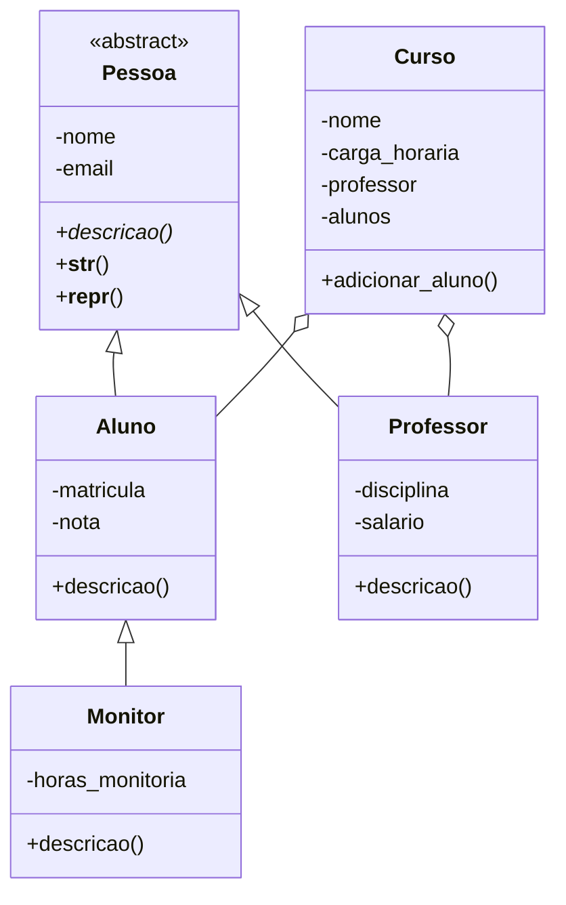

# Semana 06 — Sistema Acadêmico Orientado a Objetos

## Objetivo
Demonstrar classes, objetos, abstração, encapsulamento, herança, polimorfismo, métodos especiais e tratamento de exceções.

## Como executar
```bash
python main.py
```
Requer Python 3.10 ou superior

## Classes
- `Pessoa`: classe abstrata (`ABC`) com atributos validados e método abstrato `descricao()`.
- `Aluno`: herda de `Pessoa`; valida nota entre 0 e 10.
- `Professor`: herda de `Pessoa`; valida salário não negativo.
- `Monitor`: herda de `Aluno` e sobrescreve `descricao()`.
- `Curso`: contém um professor e uma lista de alunos, demonstrando composição/associação.

Todas as classes têm `__init__` e `__str__`; `Pessoa` e `Curso` também demonstram `__repr__`, e as subclasses herdam ou sobrescrevem os métodos conforme necessário.

## Diagrama de classes



## Decisões de modelagem
A herança representa a relação “é um”: aluno e professor são pessoas; monitor é um aluno com responsabilidade adicional. `Curso` mantém uma referência ao professor e uma coleção de alunos, o que representa associação/composição sem fazer o curso herdar de pessoa.

As propriedades (`@property`) impedem nome vazio, e-mail sem estrutura mínima, nota fora de 0–10 e salário negativo. O método `descricao()` é sobrescrito nas subclasses; a mesma chamada produz respostas diferentes, demonstrando polimorfismo.


